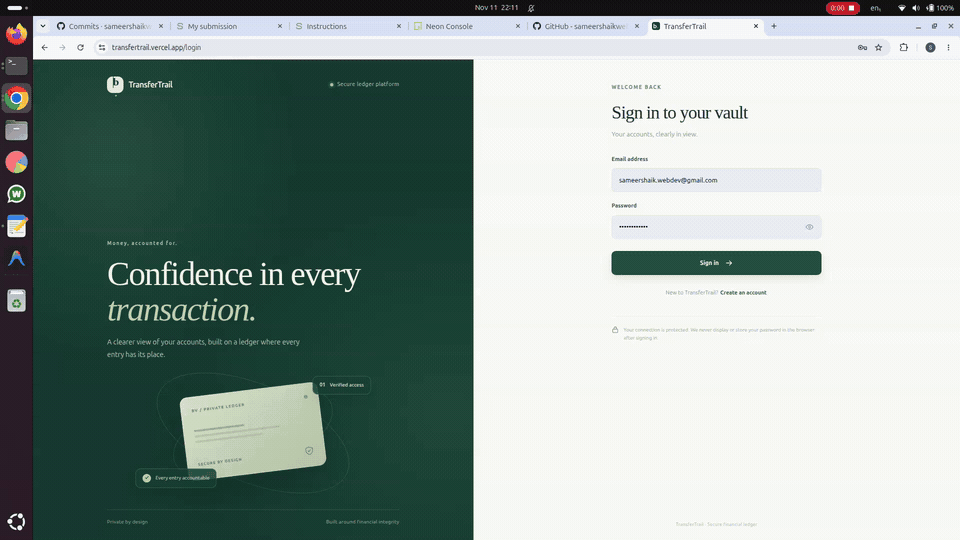

# BalanceVault

BalanceVault is a financial ledger application with a React/Vite frontend, an Express API, and PostgreSQL. Financial amounts are integer paise; all money movement is performed by protected PostgreSQL functions.

## Local development

Requirements: Node.js 24, npm 10 or 11, PostgreSQL 17, and a Redis-compatible service for auth rate limiting.

```sh
npm ci
cp .env.example .env
# Provision the roles and database described below, then fill in .env.
# Generate JWT_ACCESS_SECRET with: openssl rand -base64 48
# Generate BALANCEVAULT_ACTOR_ASSERTION_KEY with: openssl rand -hex 32
npm run db:generate
npm run db:migrate
npm run admin:provision-actor-key -w apps/api
npm run admin:bootstrap -w apps/api
npm run dev
```

Start PostgreSQL and Redis before running these commands. The frontend uses the API URL configured by `VITE_API_BASE_URL`. The API connects to PostgreSQL and Redis using the settings in `.env`.

The frontend runs at `http://localhost:5173` and the API at `http://localhost:3001`. Run either app with `npm run dev:web` or `npm run dev:api`.

## Database roles and migrations

Provision roles with an administrator by reviewing and applying `apps/api/prisma/roles.sql`. Create the database owned by `balancevault_migration_owner`; run Prisma migrations only with `MIGRATION_DATABASE_URL`. The API uses `DATABASE_URL` for ordinary queries and a separate read-only `AUTH_DATABASE_URL` for password verification. The latter alone can read `User.passwordHash`; neither login may inherit migration or function-owner roles. Create a login for each runtime role, grant its corresponding role with inheritance, and set its connection URL in `.env`. Create a separate login for bootstrap as shown below. Keep migration credentials separate from the deployed API service.

```sh
npm run db:generate
npm run db:migrate
```

### First administrator and privileged invitations

Public registration always creates an `ACCOUNT_HOLDER`. After applying the privileged-provisioning migration and provisioning `balancevault_bootstrap_operator`, an authorized operator runs `npm run admin:bootstrap -w apps/api` with a separate `BALANCEVAULT_BOOTSTRAP_DATABASE_URL`. The CLI confirms the database name, prompts for the first administrator's details, hides password input, and sends only a bcrypt hash to the one-time PostgreSQL bootstrap function. Do not configure this connection on the API service.

An authorized database administrator creates the operator login separately, after applying `apps/api/prisma/roles.sql` and the migrations:

```sql
CREATE ROLE balancevault_bootstrap_login LOGIN NOINHERIT;
GRANT balancevault_bootstrap_operator TO balancevault_bootstrap_login;
```

Set its password interactively with `\password balancevault_bootstrap_login` in `psql`, then use that login only in `BALANCEVAULT_BOOTSTRAP_DATABASE_URL`. Do not put the password in this repository or the API service environment.

After bootstrap, an administrator can create one-time ADMIN or AUDITOR invitations in User Management. Copy and securely deliver the invitation link; it is shown once and expires after 48 hours. The invitee chooses their own password. Invitation tokens are 256-bit random values; only SHA-256 hashes are stored. Invitations can be revoked before acceptance. Email delivery is not configured in this project.

The initial migration explicitly switches to `balancevault_posting_owner` while creating its private functions and setting their ACLs. This fixes the migration role's `NOINHERIT` ownership boundary: membership permits an explicit `SET ROLE`, but does not otherwise confer owner privileges. The SQL change is limited to migration privilege sequencing; it does not change financial function bodies or their runtime grants. Because the already-published initial migration checksum changes, databases that recorded the previous version must not be redeployed against it without a deliberate Prisma migration-history reconciliation. New environments should use the corrected history from the outset.

## Deployment

For the fastest free hackathon demo, follow the [Vercel + Render + Neon + Upstash deployment guide](docs/DEMO_DEPLOYMENT.md). The API starts with `npm start`; Render's blueprint generates the Prisma client during its build. Vercel builds only the frontend with `npm run build -w apps/web`. For broader deployment and recovery guidance, see [Deployment configuration](docs/DEPLOYMENT.md).

Useful commands:

```sh
npm test
npm run build
npm run db:migrate
```

See [API documentation](docs/API.md) and [architecture](docs/ARCHITECTURE.md).

See [frontend authentication and session storage](docs/FRONTEND.md) for the browser token strategy and its security limitations.

## Administrator account permissions

Administrators can open **Accounts → Manage permissions**, or open an individual account and select **Manage permissions**. Each assigned account holder has Deposit, Withdraw, and Transfer checkboxes. Saving requires an active administrator, active customer account, and active holder with viewing access. Changes and their previous values are recorded as `ACCOUNT_PERMISSIONS_UPDATED` in the audit log. Concurrent edits return a conflict and require reloading before another save.

After installing this update, run `npm run db:migrate` from the project root, then restart `npm run dev`. Existing permission rows are loaded as stored, including manually granted demo permissions. The migration adds the signed permission-management function and extends the actor assertion verifier. Its signing key uses the existing actor assertion configuration.

This feature manages transaction authorization. Deposits and withdrawals also require the configured internal clearing accounts.

## Implemented workflows

- Account-holder registration, login, profile updates, password changes, and logout.
- Account opening requests with administrator approval or rejection.
- Account balances, deposits, withdrawals, transfers, transaction history, and paginated statements.
- Administrator account and user management, one-time privileged invitations, and audit views.
- Read-only auditor views restricted to assigned customer accounts.

Financial posting uses a PostgreSQL-controlled double-entry ledger. Amounts are integer paise, ledger entries are append-only, account locks prevent concurrent overdrafts, and idempotency keys make retries safe. The frontend does not update balances or decide authorization.

### Read-only ledger reconciliation

Run `npm run ledger:reconcile -w apps/api` with `RECONCILIATION_DATABASE_URL` set to a least-privilege login that inherits only `balancevault_runtime`. The command checks that every stored account balance equals the sum of its signed ledger entries inside one repeatable-read, read-only transaction. It prints mismatches and exits with status 2 if any are found; it never repairs balances. Run it after data migrations/imports and on an operator-approved schedule, and investigate discrepancies before taking corrective action.

## Architecture and security

The API is organized into Express routes, services, database clients, and middleware under `apps/api/src`. PostgreSQL owns posting, balances, audit events, onboarding, and privileged provisioning logic. `DATABASE_URL` is for ordinary runtime operations; `AUTH_DATABASE_URL` is a separate read-only identity for password-hash verification. Redis backs shared authentication rate limits. See [architecture](docs/ARCHITECTURE.md), [API reference](docs/API.md), and [threat model](docs/THREATS.md).

Environment variable names and their purpose are listed in `.env.example` and [deployment configuration](docs/DEPLOYMENT.md). Never put secret values in source control. Production requires HTTPS, exact HTTPS `WEB_ORIGIN` entries, PostgreSQL TLS, a dedicated Redis service, and separate migration and runtime credentials.

## Testing and release checks

```sh
npm test
npm test -w apps/web
npm run db:generate
npx prisma validate --config apps/api/prisma.config.js
npm run build
git diff --check
```

PostgreSQL integration tests run only when the `BALANCEVAULT_TEST_*` variables point at disposable databases ending in `_test`. Their setup and role requirements are in [development handoff](docs/DEVELOPMENT_HANDOFF.md). Do not point these variables at `balancevault_dev` or production.

## 🎬 Demo

**Live Website:** https://transfertrail.vercel.app/

### Full Demo Video
[Watch the TransferTrail Demo](YOUR_VIDEO_LINK)

### Quick Preview


## Deployment and recovery

Use the controlled checklist in [deployment configuration](docs/DEPLOYMENT.md). Back up before schema releases with `pg_dump --format=custom --file=balancevault-$(date +%Y%m%dT%H%M%S).dump "$DATABASE_URL"`; restore into a separate recovery database with `pg_restore --no-owner --dbname="$RECOVERY_DATABASE_URL" backup.dump`, then validate before any cutover. Keep the backup encrypted and access-controlled. Do not restore over an existing database as a routine rollback; use a reviewed recovery plan.

AI-assisted development history is recorded only when supported by an available prompt or session record in [PROMPTS.md](docs/PROMPTS.md). Current implementation status and known limits are in [development handoff](docs/DEVELOPMENT_HANDOFF.md).
